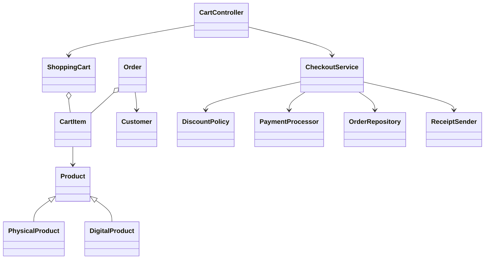

# Кошик інтернет-магазину: ЛР1 GRASP і ЛР2 SOLID

Навчальний Java-проєкт виконує дві лабораторні роботи в одній предметній області.
Система дозволяє додати фізичні й цифрові товари до кошика, обчислити суму,
застосувати знижку та оформити замовлення.

Авторки: **Бикова Поліна та Гудан Ванесса**. Репозиторій команди:
[`faenxi/architecture`](https://github.com/faenxi/architecture).

## Готові документи

- [`reports/LR1_GRASP_Online_Store_Cart.docx`](reports/LR1_GRASP_Online_Store_Cart.docx) — оформлений звіт до ЛР1;
- [`reports/LR2_SOLID_Online_Store_Cart.docx`](reports/LR2_SOLID_Online_Store_Cart.docx) — оформлений звіт до ЛР2;
- [`reports/Defense_Guide_GRASP_SOLID.docx`](reports/Defense_Guide_GRASP_SOLID.docx) — короткий сценарій захисту, питання та відповіді.

На титульних сторінках заповнено ЧНУ, ННІФТКН, кафедру ПЗКС, імена авторок
та місто Чернівці. Лінії залишено лише для групи та викладача.

## Вимоги

- JDK 17 або новіша версія;
- сторонні бібліотеки не потрібні.

## Швидкий запуск

У корені проєкту виконайте:

```bash
./run.sh lab1
./run.sh lab2
./run.sh test
./run.sh javadoc
```

Якщо файл не має права на запуск, спочатку виконайте `chmod +x run.sh`.

## Предметні класи та зв'язки

У проєкті більше п'яти класів предметної області:

1. `Product` - базовий товар;
2. `PhysicalProduct` - фізичний товар;
3. `DigitalProduct` - цифровий товар;
4. `CartItem` - рядок кошика;
5. `ShoppingCart` - кошик;
6. `Customer` - покупець;
7. `Order` - замовлення;
8. `OrderStatus` - стан замовлення.

Зв'язки:

- **наслідування:** `PhysicalProduct` і `DigitalProduct` успадковують `Product`;
- **агрегація:** `ShoppingCart` містить колекцію `CartItem`, а `Order` зберігає
  незмінний знімок рядків;
- **асоціація:** `Order` пов'язане з `Customer`.



## ЛР1: відповідність GRASP

| Принцип | Реалізація |
|---|---|
| Information Expert | `CartItem.getLineTotal()` знає ціну і кількість; `ShoppingCart.getSubtotal()` знає всі рядки. |
| Creator | `ShoppingCart.addProduct()` створює `CartItem`, які він агрегує. |
| Controller | `CartController` приймає зовнішні команди й делегує їх моделі та сервісу. |
| Low Coupling | `CheckoutService` залежить від інтерфейсів, подання - лише від `CartQueries`. |
| High Cohesion | Кошик рахує кошик, політика рахує знижку, репозиторій зберігає, подання виводить. |
| Polymorphism | `Product` має два підкласи, `DiscountPolicy` - взаємозамінні реалізації. |
| Pure Fabrication | `CheckoutService` та `InMemoryOrderRepository` виконують сервісні обов'язки. |
| Indirection | `CartController` і `CheckoutService` є проміжними шарами між UI, моделлю та інфраструктурою. |
| Protected Variations | Змінні платіжні, цінові та сховищні механізми приховані за інтерфейсами. |

Окремий опис роботи: [`docs/REPORT_LAB1_GRASP.md`](docs/REPORT_LAB1_GRASP.md).

## ЛР2: відповідність SOLID

| Принцип | Реалізація |
|---|---|
| SRP | Кожний клас має одну основну причину для зміни. |
| OCP | Нову знижку можна додати новим класом `DiscountPolicy`, не змінюючи оформлення. |
| LSP | `NoDiscountPolicy` та `PercentageDiscountPolicy` дотримуються одного контракту й взаємозамінні. |
| ISP | Команди й запити кошика розділено на `CartCommands`/`CartQueries`; оплату й чек - на `PaymentProcessor`/`ReceiptSender`. |
| DIP | `CheckoutService` отримує всі зовнішні залежності як інтерфейси через конструктор. |

Окремий опис роботи: [`docs/REPORT_LAB2_SOLID.md`](docs/REPORT_LAB2_SOLID.md).

## Структура

```text
src/main/java/ua/edu/shopcart/
├── application/  вузькі інтерфейси команд і запитів
├── controller/   GRASP-контролер
├── demo/         Lab1Demo і Lab2Demo
├── domain/       предметні класи
├── payment/      оплата та надсилання чека
├── pricing/      політики знижок
├── repository/   абстракція і реалізація сховища
├── service/      оформлення замовлення
└── view/         консольне подання
```

Зовнішні бізнес-операції, яких немає сенсу реалізовувати в навчальному
проєкті, зроблено заглушками з виводом назви методу й аргументів:
`ConsolePaymentProcessor`, `ConsoleReceiptSender`, `InMemoryOrderRepository`.

## Документація

Усі класи, інтерфейси, поля й методи мають Javadoc. Команда `./run.sh javadoc`
створює автоматичну HTML-документацію в каталозі `docs/javadoc`.
